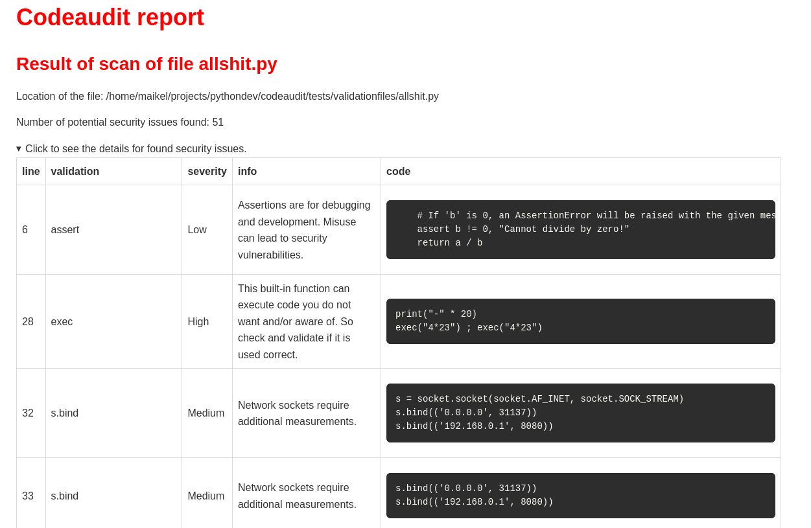

# Command `codeaudit filescan`

The **Python Code Audit** `filescan` command efficiently scans Python files, directories, or source packages to:

1. Identify and report potential security weaknesses.
2. [Detect Data Exfiltration](data_exfiltration_detection.md).

The tool generates a report detailing discovered security issues and flagging any **External Egress Risks** identified within the Python code.

See the section on [validations](checksinformation.md) for an overview of all implemented security checks.

To use the `filescan` feature, run the following command in the console:

```text
codeaudit filescan <pythonfile|package-name|directory|package.tar.gz> [OUTPUTFILE]
```

The `<package.tar.gz>` input can be either a **local** `.tar.gz` source archive or a **remote** `.tar.gz` archive URL.

**Python Code Audit** will create a detailed security scan report for any of the following:

* A single local Python file.
* A local directory containing Python source code.
* A package hosted on [PyPI.org](http://PyPI.org).
* A local `.tar.gz` source package.
* A remote `.tar.gz` source package.


If you do not specify [OUTPUTFILE], a HTML output file, a HTML report file is created in the current directory and will be named codeaudit-report.html.

When running `codeaudit filescan` detailed information is determined for a Python file or package based on more than 70 validations implemented.

The `filescan` report lists all identified security weaknesses that could lead to a security vulnerability.

Per line a the in construct that can cause a security risks is shown, along with the relevant code lines where the issue is detected.



(excluded_directories)=
## Excluded directories

:::{note} 
The `codeaudit filescan` command does **NOT** include all directories. This is done on purpose!

The following directories are skipped by default:
* `/docs`
* `/docker`
* `/dist`
* `/tests`
* all directories that start with `.` (dot) or `_` (underscore)
:::


## Example

```
codeaudit filescan ./codeaudit/tests/validationfiles/allshit.py 
Codeaudit report file created!
Check the report file: file:///home/maikel/tmp/codeaudit-report.html
```

Example report of a [codeaudit filescan report](examples/filescan.html) that is generated with the command `codeaudit filescan pythondev/codeaudit/tests/validationfiles/allshit.py`


## Help

```
NAME
    codeaudit filescan - Scans Python source code or PyPI packages for security weaknesses.

SYNOPSIS
    codeaudit filescan INPUT_PATH <flags>

DESCRIPTION
    * A local directory containing Python source code
    * A single local Python file
    * The name of a package hosted on PyPI

    codeaudit filescan <pythonfile|package-name|directory> [reportname.html] [--nosec]

    Based on the input type, the function analyzes the source code for potential
    security issues, generates an HTML report summarizing the findings, and
    writes the report to disk.

    If a PyPI package name is provided, the function downloads the source
    distribution (sdist), extracts it to a temporary directory, scans the
    extracted source code, and cleans up all temporary files after the scan
    completes.

     Examples:

        Scan a local directory and write the report to ``report.html``::

            codeaudit filescan /path/to/custompythonmodule report.html

        Scan a local directory::

            codeaudit filescan /path/to/project

        Scan a single Python file::

            codeaudit filescan myexample.py

        Scan a package hosted on PyPI::

            codeaudit filescan linkaudit

            codeaudit filescan requests

        Specify an output report file::

            codeaudit filescan /path/to/project report.html

        Enable filtering of issues marked with ``#nosec`` or another marker on potential code weaknesses that mitigated or known  ::

            codeaudit filescan myexample.py --nosec

    POSITIONAL ARGUMENTS
    INPUT_PATH
        Path to a local Python file or directory, or the name of a package available on PyPI.

    FLAGS
    -f, --filename=FILENAME
        Default: 'codeaudit-report.html'
        Name (and optional path) of the HTML file to write the scan report to. The filename should use the ``.html`` extension. Defaults to ``DEFAULT_OUTPUT_FILE``.
    -n, --nosec=NOSEC
        Default: False
        Whether to filter out issues marked as reviewed or ignored in the source code. Defaults to ``False``, no filtering.


    NOTES
        You can also use flags syntax for POSITIONAL ARGUMENTS
```